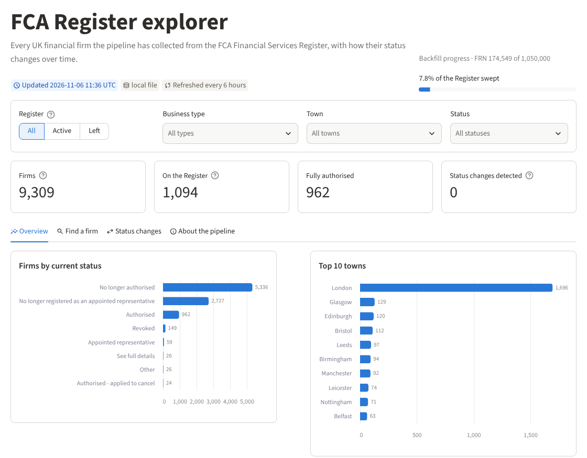
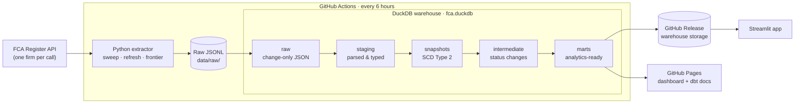

# FCA Register Pipeline

**An automated ELT pipeline that builds and maintains a historical dataset of every firm on the UK Financial Conduct Authority's Financial Services Register.**

[](https://github.com/Daudsaid/fca-pipeline/actions/workflows/ci.yml)
[](https://github.com/Daudsaid/fca-pipeline/actions/workflows/daily_pipeline.yml)


**[Live app](https://fca-pipeline.streamlit.app)** · **[Dashboard](https://daudsaid.github.io/fca-pipeline/)** · **[dbt docs & lineage](https://daudsaid.github.io/fca-pipeline/dbt/)**



---

## Contents

- [Overview](#overview)
- [Architecture](#architecture)
- [Engineering highlights](#engineering-highlights)
- [Data model](#data-model)
- [Extraction strategy](#extraction-strategy)
- [Getting started](#getting-started)
- [Orchestration and deployment](#orchestration-and-deployment)
- [Testing and data quality](#testing-and-data-quality)
- [Project structure](#project-structure)
- [Design decisions](#design-decisions)
- [Limitations and roadmap](#limitations-and-roadmap)
- [Data source](#data-source)

---

## Overview

The FCA's Financial Services Register lists every firm authorised or registered to carry out financial services in the UK: banks, insurers, investment firms, payment and e-money institutions, and their appointed representatives. The Register only ever shows the **current** state of each firm. It does not offer a bulk download on its free tier or keep an accessible history of how a firm's status has changed.

This project fills that gap. It:

1. **Extracts** firm records from the FCA Register API, working around a one-firm-per-call, rate-limited API with no "list all" endpoint.
2. **Loads** the raw JSON into a DuckDB warehouse, storing a new version only when a firm actually changes.
3. **Transforms** it with dbt into clean, tested models, including a **Slowly Changing Dimension (Type 2)** snapshot that records every change in a firm's status, name, type or location over time.
4. **Serves** the results through a Streamlit app, a static dashboard and published dbt documentation.

The whole pipeline runs unattended on GitHub Actions every six hours, with no servers, databases or containers to maintain.

| Question the data answers | Where |
|---|---|
| Which firms are authorised right now, and where are they based? | `marts.mart_fca_firms_current` |
| When did a firm's authorisation status change, and from what to what? | `intermediate.int_fca_status_changes` |
| How many firms leave the Register each year? | `marts.mart_fca_firms_current` (status + FCA effective date), app & dashboard |
| How often do statuses change, and in which direction? | `marts.mart_fca_status_changes_monthly` |
| What did a firm look like at any point in time? | `snapshots.snap_fca_firms` |

---

## Architecture



**Pattern: ELT.** Raw API responses land in the warehouse untouched, and all parsing and business logic lives in version-controlled, tested dbt SQL. Fixing a bug or adding a field means editing a model and re-running `dbt build`, not re-calling a rate-limited API for hours.

| Layer | Technology | Responsibility |
|---|---|---|
| Extract | Python, `requests` | Rate-limited, retrying, resumable API client and crawler |
| Load + store | DuckDB 2.0 | Single-file columnar warehouse; reads JSONL natively |
| Transform | dbt Core + `dbt-duckdb` | Staging, SCD2 snapshot, intermediate and mart models, plus 19 data tests |
| Orchestrate | GitHub Actions | Scheduled runs, CI, warehouse persistence, Pages deployment |
| Serve | Streamlit, static HTML, dbt docs | Interactive exploration, public dashboard, lineage |

---

## Engineering highlights

- **Complete coverage from a limited API.** The free API has no bulk endpoint, so the extractor *sweeps* the firm reference number (FRN) space, *refreshes* known firms in rotation, and scans the *frontier* of newly issued FRNs daily (see [Extraction strategy](#extraction-strategy)).
- **Fault-tolerant, resumable extraction.**
  - **Checkpointing:** progress is saved to a state file, so Ctrl+C, a crash or a CI timeout (handled through `SIGTERM`) never loses more than a few records.
  - **Outages:** an API outage raises a dedicated `FCAUnavailable` error rather than being misread as "firm does not exist", so the checkpoint never skips past failures.
- **Adaptive rate limiting.** The client backs off when it receives HTTP 429 (×1.5 per throttle) and recovers gradually after sustained success, settling at the fastest pace the API accepts.
- **Change-only raw storage.** Each record is hashed (ignoring the API's own response timestamp), and only genuinely changed versions are stored. Redundant self-link fields are dropped, cutting storage by ~37%. Re-running any load is idempotent.
- **Full history with SCD Type 2.** A dbt snapshot opens a new row whenever a tracked attribute changes, and custom tests guarantee that history periods never overlap and that each firm has exactly one current row.
- **Serverless operations.** The warehouse lives as a GitHub Release asset between runs, which avoids git's 100 MB file limit and needs no database server. Every run downloads it, updates it, re-uploads it and republishes the dashboard.
- **Tested at two levels.** Unit tests exercise the client and crawler against an in-process stand-in for the FCA API, covering outages, throttling, resumption and frontier discovery. dbt tests validate the data on every build.

---

## Data model

All models live in a single DuckDB file, organised by schema.

| Schema | Model | Grain | Description |
|---|---|---|---|
| `raw` | `raw_fca_firms` | firm × version | API JSON as returned (self-links removed). New row only when content changes. Incremental. |
| `staging` | `stg_fca_firms` | firm | Latest version of each firm, with JSON parsed into typed columns, dates normalised, placeholder values (`NA`) nulled, and the principal place of business selected from the address list. |
| `snapshots` | `snap_fca_firms` | firm × validity period | SCD Type 2 history on name, status, sub-status, business type and postcode (`dbt_valid_from` / `dbt_valid_to`). |
| `intermediate` | `int_fca_status_changes` | status transition | Each status change, with the FCA's effective date and the time the pipeline detected it. |
| `marts` | `mart_fca_firms_current` | firm | Current state of every firm: the open snapshot rows. |
| `marts` | `mart_fca_status_summary` | status | Firm counts and share by current status. |
| `marts` | `mart_fca_status_changes_monthly` | month × transition | Monthly trend of status transitions. |

Example: the full tracked history of one firm.

```sql
select frn, firm_name, status, dbt_valid_from, dbt_valid_to
from snapshots.snap_fca_firms
where frn = '124655'
order by dbt_valid_from;
```

Browse every model, column and its lineage in the **[published dbt docs](https://daudsaid.github.io/fca-pipeline/dbt/)**.

---

## Extraction strategy

The FCA Register API returns **one entity per request** and is rate limited. There is no endpoint that lists all firms. The extractor (`extract/extract_fca.py`) combines several resumable modes to achieve complete, current coverage:

| Mode | Purpose | How |
|---|---|---|
| `sweep` | **Backfill:** discover every firm | Requests each FRN from 100,000 to 1,050,000 and keeps those that exist. Position is checkpointed. |
| `refresh` | **Freshness:** detect changes | Re-fetches known firms, least recently checked first, so the whole set rotates continuously. |
| `frontier` | **New registrations** | Once a day, scans 3,000 FRNs below to 1,000 above the highest FRN seen, because FRNs are issued roughly in sequence but can appear on the Register after a delay. |
| `search` | Quick targeted discovery | Uses the Search endpoint with common terms. |
| `auto` | Scheduled default | `refresh`, then `frontier` once a day, then `sweep` for the remaining time budget. |
| `status` | Monitoring | Prints coverage and sweep progress without calling the API. |

Each fetched firm is written as one JSON line, holding the firm record plus its addresses, to `data/raw/firms_<date>.jsonl`. dbt then loads these files incrementally.

```bash
python extract/extract_fca.py status                        # progress, no API calls
python extract/extract_fca.py sweep --max-minutes 600       # 10-hour backfill chunk
python extract/extract_fca.py refresh --limit 500
python extract/extract_fca.py --help
```

---

## Getting started

### Prerequisites

- Python 3.13 (with [uv](https://docs.astral.sh/uv/) recommended)
- A free FCA Register API key: register at [register.fca.org.uk/Developer](https://register.fca.org.uk/Developer/s/)
- Optional: the [GitHub CLI](https://cli.github.com/) to download the latest published warehouse

### Setup

```bash
git clone https://github.com/Daudsaid/fca-pipeline.git
cd fca-pipeline

uv venv --python 3.13 .venv && source .venv/bin/activate
uv pip install -r requirements.txt

cp .env.example .env          # then add FCA_API_EMAIL and FCA_API_KEY
```

### Run

```bash
bash run_pipeline.sh --skip-extract        # build the warehouse from the bundled seed data (no API calls)
bash run_pipeline.sh --limit 50            # refresh 50 firms from the live API, then dbt build
bash run_pipeline.sh sweep --max-minutes 60
```

`run_pipeline.sh` runs the extractor and then `dbt build`, which loads, transforms and tests in dependency order. If the extract stops early, dbt still builds on everything fetched so far.

### Use the latest published data instead

```bash
gh release download warehouse -R Daudsaid/fca-pipeline -p fca.duckdb --clobber
```

### Explore

```bash
uv pip install -r app/requirements.txt
streamlit run app/streamlit_app.py         # interactive explorer at http://localhost:8501

python dashboard/build_dashboard.py        # static dashboard -> site/index.html
```

The warehouse is a standard DuckDB file, so you can also query it from the DuckDB CLI, Python, or a SQL client such as DBeaver (use a DuckDB 2.x driver).

```sql
select * from marts.mart_fca_status_summary;

select frn, firm_name, town, status_effective_date
from marts.mart_fca_firms_current
where status = 'authorised' and firm_name ilike '%bank%'
order by status_effective_date desc;
```

### Configuration

| Variable | Default | Description |
|---|---|---|
| `FCA_API_EMAIL`, `FCA_API_KEY` | (required) | FCA Register API credentials |
| `FCA_FIRM_LIMIT` | `2000` | Firms to refresh per run |
| `FCA_MIN_INTERVAL` | `0.5` (local), `0.25` (CI) | Seconds between API calls; adjusts automatically on HTTP 429 |
| `FCA_DUCKDB_PATH` | | Point the Streamlit app at a specific warehouse file |

---

## Orchestration and deployment

| Workflow | Trigger | What it does |
|---|---|---|
| [`daily_pipeline.yml`](.github/workflows/daily_pipeline.yml) | Every 6 hours (00:17, 06:17, 12:17, 18:17 UTC) and on demand | Downloads the warehouse from the `warehouse` release, refreshes 750 firms, runs the frontier scan, sweeps for the remaining time (max ~4.8 h), runs `dbt build`, uploads the warehouse, and publishes the dashboard and dbt docs to GitHub Pages |
| [`ci.yml`](.github/workflows/ci.yml) | Every push and pull request | Unit tests, plus a full `dbt build` with all data tests on the seed data |

**Why a GitHub Release for storage?** At full coverage the warehouse exceeds git's 100 MB file limit. A release asset (up to 2 GB) gives durable, versionless storage that the workflow and the Streamlit app can both read with no extra infrastructure. Runs never overlap, thanks to a workflow concurrency group.

**Deploying your own copy**

1. Fork the repo and add the repository secrets `FCA_API_EMAIL` and `FCA_API_KEY` (**Settings → Secrets and variables → Actions**). Optionally add the variables `FCA_FIRM_LIMIT` and `FCA_MIN_INTERVAL`.
2. Enable Pages: **Settings → Pages → Source: GitHub Actions**.
3. Start the first run from **Actions → FCA pipeline → Run workflow**.
4. Deploy the app on [Streamlit Community Cloud](https://share.streamlit.io) with main file `app/streamlit_app.py`. Set `FCA_REPO` if your fork has a different name.

---

## Testing and data quality

```bash
uv pip install -r requirements-dev.txt
python -m pytest -v tests                  # 14 unit tests against a stand-in FCA API
bash run_pipeline.sh --skip-extract        # dbt build + 19 data tests on the seed data
```

**Unit tests (`tests/`)** spin up an in-process HTTP server that imitates the FCA Register API and verify that:
- missing firms and outages are told apart
- the client slows down on HTTP 429 and recovers afterwards
- a sweep finds exactly the firms that exist, resumes without gaps or duplicates, and keeps its checkpoint through an outage
- refresh works oldest-first and rotates firms the API no longer returns
- the frontier scan discovers newly registered firms and runs at most once a day
- time limits stop the run cleanly

**dbt tests** cover uniqueness and non-null keys at every layer, plus two custom tests on the SCD2 snapshot:
- `assert_snapshot_periods_do_not_overlap`: no firm has overlapping validity windows.
- `assert_one_current_row_per_firm`: every firm has exactly one open row.

---

## Project structure

```
fca-pipeline/
├── extract/
│   ├── fca_client.py          # API client: auth, adaptive rate limiting, retries
│   └── extract_fca.py         # crawler: sweep / refresh / frontier / search, checkpointed state
├── dbt/fca_dbt/
│   ├── models/
│   │   ├── raw/               # incremental, change-only load of JSONL into DuckDB
│   │   ├── staging/           # parsing, typing, cleaning
│   │   ├── intermediate/      # status transitions
│   │   └── marts/             # analytics-ready tables
│   ├── snapshots/             # SCD Type 2 history
│   ├── macros/                # date parsing, text cleaning, schema naming
│   └── tests/                 # custom data tests
├── app/streamlit_app.py       # interactive explorer
├── dashboard/                 # static HTML dashboard generator
├── tests/                     # pytest suite with a stand-in FCA API
├── .github/workflows/         # scheduled pipeline + CI
├── data/raw/                  # extractor output (seed data committed)
└── run_pipeline.sh            # extract -> dbt build
```

---

## Design decisions

| Decision | Rationale | Trade-off |
|---|---|---|
| **DuckDB** over Postgres or a cloud warehouse | Zero infrastructure, fast columnar analytics, native JSON and JSONL support; the whole warehouse is one portable file | Single writer; not designed for concurrent multi-user writes |
| **ELT** with raw JSON preserved | Transformations can be changed and re-run without re-extracting from a slow, rate-limited API | Raw layer uses more storage than pre-shaped tables, which change-only storage mitigates |
| **Change-only raw layer** | Most firms are unchanged between checks; storing every fetch would grow the warehouse by megabytes per day for no new information | The raw table records versions, not every check |
| **SCD2 with the `check` strategy** | The API offers no reliable "last modified" field, so changes are detected by comparing tracked columns | Changes are timestamped when detected; the FCA's own effective date is kept alongside |
| **No hard-delete invalidation** in the snapshot | During the backfill, a firm missing from one run has not necessarily left the Register | Real removals are reflected through the firm's FCA status rather than deletion |
| **GitHub Actions + Releases** instead of Airflow and a hosted database | No servers to run or pay for; the schedule, logs, storage and CI live alongside the code | Runs are capped at 6 hours each, which the time-budgeted, resumable extractor is designed around |

---

## Limitations and roadmap

**Current limitations**
- **Partial coverage during the backfill.** Coverage grows with every run; the live app shows sweep progress.
- **History starts on day one.** It begins when the pipeline first observed each firm; earlier changes are reflected only through the FCA's own "status effective date".
- **Firm-level data only.** Approved individuals, permissions and disciplinary history are available from the API but not yet extracted.

**Roadmap**
- [ ] Extract permissions and approved persons per firm
- [ ] Enrich with Companies House data (incorporation date, SIC codes, officers)
- [ ] Geocode postcodes for a map of authorised firms
- [ ] Alerting on notable status changes (for example, a newly revoked authorisation)

---

## Data source

Data comes from the [FCA Financial Services Register](https://register.fca.org.uk/) via its public API. This is an independent portfolio project, not affiliated with or endorsed by the Financial Conduct Authority. Always confirm a firm's status on the official Register before relying on it.

---

**Author:** Daud Abdi · [GitHub @Daudsaid](https://github.com/Daudsaid)
